# SaaS Salon Management System
## Complete System Documentation

**Document Version:** 1.1  
**Generated:** September 9, 2026  
**Codebase:** Salon-Saas (`d:\DartCodes\Salon-Saas`)  
**Classification:** Client Presentation · Software Handover · Developer Onboarding · Technical Reference

---

# Table of Contents

1. [Executive Summary](#1-executive-summary)
2. [System Overview](#2-system-overview)
3. [Technology Stack](#3-technology-stack)
4. [High Level Architecture](#4-high-level-architecture)
5. [SaaS Architecture](#5-saas-architecture)
6. [User Roles and Permission System](#6-user-roles-and-permission-system)
7. [Subscription Plan Management](#7-subscription-plan-management)
8. [Dashboard Documentation](#8-dashboard-documentation)
9. [Module Documentation](#9-module-documentation)
10. [Database Documentation](#10-database-documentation)
11. [API Documentation](#11-api-documentation)
12. [Authentication and Security](#12-authentication-and-security)
13. [File Upload and Storage System](#13-file-upload-and-storage-system)
14. [Deployment Documentation](#14-deployment-documentation)
15. [Testing Documentation](#15-testing-documentation)
16. [Business Process Documentation](#16-business-process-documentation)
17. [Missing Features / Future Improvements](#17-missing-features--future-improvements)
18. [Final System Summary](#18-final-system-summary)

---

# 1. Executive Summary

## What is SaaS Salon?

SaaS Salon is a **multi-tenant SaaS platform** designed for salon and beauty businesses. It provides a centralized web application where each salon operates as an isolated tenant with its own data, users, branches, customers, services, inventory, point-of-sale, appointments, and reporting — while a platform **Super Admin** manages tenants, subscription plans, and feature entitlements.

## Business Problem Solved

| Problem | How the System Addresses It |
|---------|----------------------------|
| Manual salon operations (paper registers, spreadsheets) | Integrated POS, inventory, customer CRM, and reports |
| Scaling software to many salons | Schema-per-tenant isolation with shared platform infrastructure |
| Different salons need different feature sets | Subscription plans with feature-based access control |
| Staff need controlled access | Role-based permissions (RBAC) per tenant |
| New salon onboarding | Public signup with PayHere payment + super-admin provisioning |

## Target Industry

- Hair salons and beauty salons
- Multi-branch salon chains (partial — branch management is implemented)
- SaaS operators selling salon management software (B2B2C model)

## Main Capabilities (Implemented)

| Capability | Status |
|------------|--------|
| Multi-tenant salon management | Implemented |
| Subscription plans (Silver, Gold, Platinum, Custom) | Implemented |
| Customer management | Implemented |
| Service & product catalog | Implemented |
| Inventory & stock movements | Implemented |
| Point of Sale (POS) | Implemented |
| Sales history & reports | Implemented |
| Appointments (staff booking, calendar) | Implemented |
| Employee & branch management | Implemented |
| Role/permission management | Implemented (requires ROLE_MANAGEMENT feature) |
| Public marketing site & self-service signup | Implemented |
| PayHere payment integration (signup) | Implemented |
| Salon logo upload | Implemented |
| Customer online booking | **Not Implemented** |
| SMS/email appointment reminders | **Not Implemented** |
| Invoice PDF generation | **Not Implemented** |

---

# 2. System Overview

## Application Purpose

Provide a full operational platform for salon businesses under a SaaS model: sign up, pay for a plan, receive feature entitlements, and run day-to-day salon operations through a web admin panel.

## Main Modules

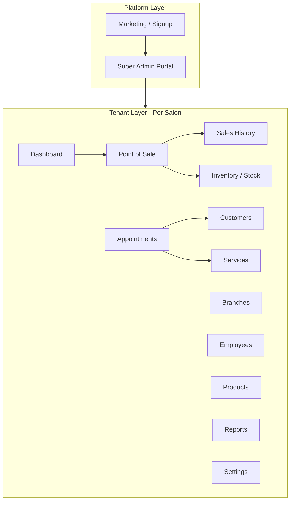

## Business Workflows

### A. Self-Service Salon Signup (Primary)

1. Visitor views marketing homepage and pricing plans
2. Selects plan → signup form (salon + admin user details)
3. Backend creates tenant (PROVISIONING), pending subscription, signup order
4. Redirect to PayHere checkout
5. PayHere webhook activates subscription and tenant features
6. Super Admin activates salon tenant (if awaiting activation)
7. Salon admin logs in at `/salon/login`

### B. Manual Salon Creation (Legacy / Super Admin)

1. Super Admin creates salon via `/super-admin/salons/new`
2. Selects manual feature flags (no subscription plan)
3. Tenant schema provisioned with admin user
4. Features managed manually by Super Admin

### C. Daily Salon Operations

1. Staff logs into salon portal
2. Manages customers, appointments, catalog
3. Processes sales via POS
4. Stock auto-reduced on product sales; manual stock-in/adjustments available
5. Views dashboard and reports

## User Types

| User Type | Portal | Description |
|-----------|--------|-------------|
| **Super Admin** | `/super-admin/*` | Platform operator; manages salons, plans, subscriptions |
| **Salon Admin** | `/salon/*` | Tenant administrator (`SALON_ADMIN` role) |
| **Cashier** | `/salon/*` | POS-focused staff (`CASHIER` role) |
| **Stock Keeper** | `/salon/*` | Inventory-focused staff (`STOCK_KEEPER` role) |
| **Custom Roles** | `/salon/*` | User-defined roles (requires `ROLE_MANAGEMENT` feature) |
| **Hair Dressers / Managers** | — | **Not Implemented** as distinct system roles. Operational staff are modeled as **Employees**; access is via assigned user roles (typically CASHIER or custom roles). |

## System Boundaries

| In Scope | Out of Scope (Not Implemented) |
|----------|-------------------------------|
| Web admin panels (salon + super admin) | Native mobile apps |
| PayHere subscription payments | In-salon POS card terminal hardware integration |
| Schema-per-tenant PostgreSQL | Shared-table multi-tenancy |
| JWT authentication | OAuth / social login |
| Logo file upload | General media library |
| Email password reset (SMTP) | SMS notifications |

---

# 3. Technology Stack

## Frontend

| Component | Technology | Version (approx.) |
|-----------|------------|-------------------|
| Framework | React | 19 |
| Language | TypeScript | 5.8 |
| Build tool | Vite | 8 |
| Routing | React Router DOM | 7 |
| Server state | TanStack React Query | 5 |
| HTTP client | Axios | — |
| Forms | React Hook Form + Zod | 7 / 3 |
| UI primitives | Radix UI | — |
| Styling | Tailwind CSS | 4 |
| Icons | Lucide React | — |
| Component pattern | shadcn/ui-style (`components/ui/`) | — |

**State management:** No Redux. Local React state + TanStack Query cache. Auth state in `AuthContext`.

## Backend

| Component | Technology |
|-----------|------------|
| Framework | NestJS |
| Language | TypeScript |
| API style | REST (JSON), prefix `/api` |
| Validation | class-validator + class-transformer |
| Auth | Passport JWT |
| Rate limiting | @nestjs/throttler (100 req/min global) |
| File upload | Multer (memory storage) |

## Database

| Component | Technology |
|-----------|------------|
| Database | PostgreSQL 17 |
| ORM | Prisma (public schema only) |
| Tenant data access | Raw SQL via Prisma `$queryRawUnsafe` |
| Migrations (public) | Prisma Migrate (`backend/prisma/migrations/`) |
| Migrations (tenant) | SQL files (`backend/src/database/tenant-migrations/`) |
| Seeding | `backend/prisma/seed.ts` |

## Infrastructure

| Component | Status |
|-----------|--------|
| Docker Compose | **Partially Implemented** — PostgreSQL container only |
| Backend Dockerfile | **Not Implemented** |
| Frontend Dockerfile | **Not Implemented** |
| CI/CD pipeline | **Not Implemented** |
| Kubernetes | **Not Implemented** |
| File storage | Local filesystem (`uploads/tenants/`) |

---

# 4. High Level Architecture

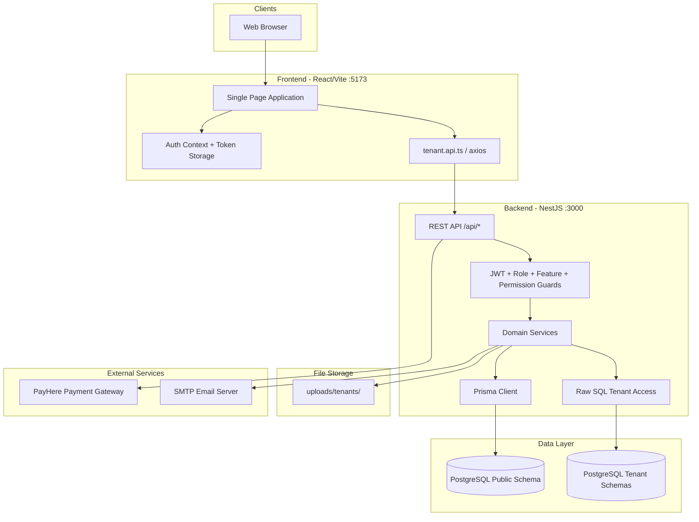

## Component Descriptions

| Component | Responsibility |
|-----------|----------------|
| **React SPA** | All UI: marketing, signup, salon admin, super admin |
| **Auth Context** | Stores JWT tokens (localStorage), manages login/logout, `/auth/me` refresh |
| **Axios interceptors** | Attach Bearer token; auto-refresh on 401 |
| **NestJS API** | Business logic, validation, authorization |
| **Prisma** | Public schema ORM (tenants, plans, subscriptions, super admins) |
| **Raw SQL layer** | Tenant schema queries with schema-qualified table names |
| **PostgreSQL public schema** | Platform metadata, subscriptions, feature catalog |
| **PostgreSQL tenant schemas** | Per-salon operational data (`tenant_000001`, etc.) |
| **Local uploads** | Salon logo files served at `/api/uploads/*` |
| **PayHere** | Subscription payment during public signup |
| **SMTP** | Password reset emails |

---

# 5. SaaS Architecture

## Multi-Tenant Approach

**Pattern:** Schema-per-tenant (PostgreSQL schema isolation)

- Each salon tenant gets a dedicated schema: `tenant_000001`, `tenant_000002`, …
- Public schema stores tenant registry and subscription entitlements
- Tenant business data is **not** in Prisma schema — managed via SQL migrations applied at provisioning

## Tenant Management

| Entity | Location | Key Fields |
|--------|----------|------------|
| Tenant | Public `tenants` | `code`, `schemaName`, `name`, `status`, `logoUrl` |
| Tenant features | Public `tenant_features` | Mirror of subscription features for visibility |
| Subscription | Public `subscriptions` | Links tenant to plan; runtime entitlement source |

**Tenant statuses:** `PROVISIONING`, `ACTIVE`, `SUSPENDED`, `PROVISION_FAILED`, `ARCHIVED`

## Salon Isolation

- JWT payload includes `tenantId` and `schemaName` for tenant users
- `TenantContextGuard` resolves tenant context per request
- All tenant queries use schema-qualified table names via `tenantTable(schemaName, 'table')`
- Cross-tenant data access is prevented by schema separation

## Subscription Management

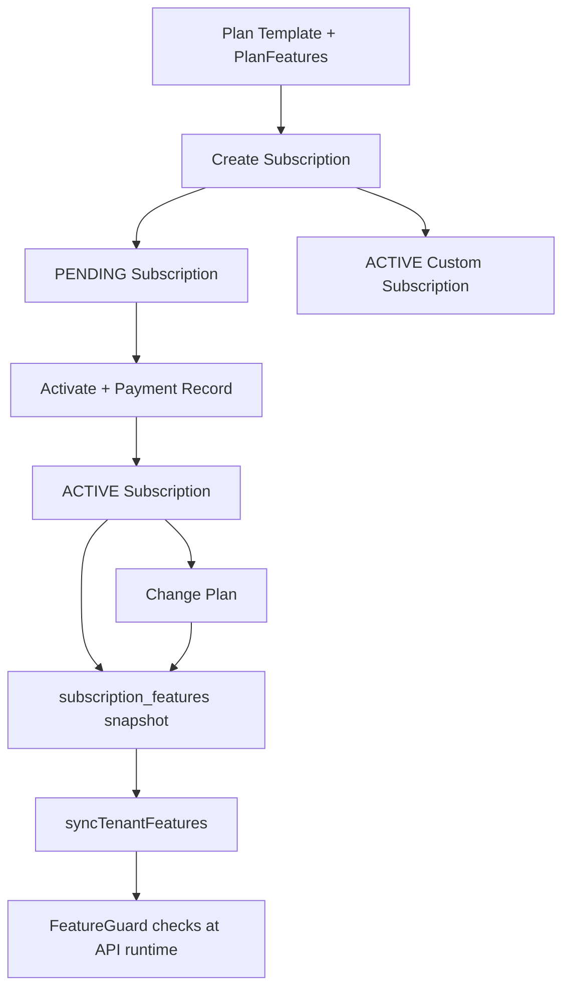

**Runtime feature check:** `FeatureGuard` → `SubscriptionFeatureService.hasFeature(tenantId, featureCode)`

## New Salon Creation Flows

### Flow 1: Public Signup (Implemented)

```mermaid
flowchart LR
  A[Customer selects plan] --> B[POST /public/signup]
  B --> C[Create Tenant PROVISIONING]
  C --> D[Create PENDING Subscription]
  D --> E[Create SignupOrder]
  E --> F[PayHere Checkout]
  F --> G[Webhook / confirm-return]
  G --> H[Activate Subscription + Features]
  H --> I[Super Admin activates salon ACTIVE]
  I --> J[Salon Admin Login]
```

### Flow 2: Super Admin Manual (Implemented)

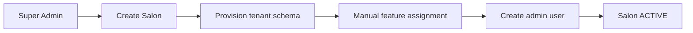

### Flow 3: Super Admin Subscription Assignment (Implemented)

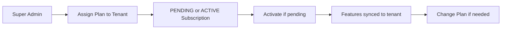

---

# 6. User Roles and Permission System

## Platform Role

### Super Admin

| Permission Area | Capabilities |
|-----------------|--------------|
| Salons | List, create, view, edit, suspend, archive |
| Salon features | Manual feature assignment (legacy salons without subscription) |
| Plans | CRUD, assign features to plan templates |
| Subscriptions | Assign, activate, change plan, create custom subscription |
| Features catalog | View platform features |
| Diagnostics | Tenant user diagnostic endpoint |

**Authentication:** `super_admin_users` table, role `SUPER_ADMIN` in JWT

## Tenant Roles (Seeded per tenant)

| Role Code | Name | Default Permissions |
|-----------|------|---------------------|
| `SALON_ADMIN` | Salon Admin | All permissions |
| `CASHIER` | Cashier | Branch view, customers, services/products view, sales, appointments |
| `STOCK_KEEPER` | Stock Keeper | Branch view, product view/create/update |

**Custom roles:** Can be created when `ROLE_MANAGEMENT` feature is enabled (Platinum plan).

## Permission Codes

| Module | View Permission | Manage Permissions |
|--------|-----------------|-------------------|
| CORE (always on) | EMPLOYEE_VIEW, USER_VIEW | EMPLOYEE_CREATE/UPDATE, USER_CREATE/UPDATE |
| BRANCH_MANAGEMENT | BRANCH_VIEW | BRANCH_CREATE, BRANCH_UPDATE |
| CUSTOMERS | CUSTOMER_VIEW | CUSTOMER_CREATE, CUSTOMER_UPDATE |
| SERVICES | SERVICE_VIEW | SERVICE_CREATE, SERVICE_UPDATE |
| INVENTORY | PRODUCT_VIEW | PRODUCT_CREATE, PRODUCT_UPDATE |
| POS | SALE_VIEW | SALE_CREATE, SALE_UPDATE |
| APPOINTMENTS | APPOINTMENT_VIEW | APPOINTMENT_CREATE, APPOINTMENT_UPDATE, APPOINTMENT_DELETE |

## Permission Matrix

| Permission | Super Admin | Salon Admin | Cashier | Stock Keeper |
|------------|:-----------:|:-----------:|:-------:|:------------:|
| Manage platform salons | ✓ | — | — | — |
| Manage subscription plans | ✓ | — | — | — |
| Assign/change tenant subscription | ✓ | — | — | — |
| Manage branches | — | ✓* | View | View |
| Manage employees | — | ✓ | View | — |
| Manage customers | — | ✓* | ✓* | — |
| Manage services | — | ✓* | View | — |
| Manage products/inventory | — | ✓* | View | ✓* |
| POS / sales | — | ✓* | ✓* | — |
| Appointments | — | ✓* | ✓* | — |
| Reports | — | ✓ | ✓ | — |
| Settings / roles | — | ✓** | — | — |
| Change own subscription plan | — | ✓ | — | — |

\* Requires subscription feature enabled for that module  
\** Role management requires `ROLE_MANAGEMENT` feature

## Authorization Layers

1. **JWT authentication** — valid token required
2. **Role guard** — `@Roles('SUPER_ADMIN')` for platform routes
3. **Tenant context guard** — resolves tenant schema
4. **Feature guard** — `@RequireFeature('CUSTOMERS')` checks subscription entitlement
5. **Permission guard** — `@RequirePermission('CUSTOMER_CREATE')` checks RBAC

---

# 7. Subscription Plan Management

## Plans (Seeded Defaults)

| Plan | Code | Price (LKR) | Billing | Features Included |
|------|------|-------------|---------|-------------------|
| Silver | `SILVER` | 5,000 | Monthly | CUSTOMERS, SERVICES |
| Gold | `GOLD` | 15,000 | Monthly | CUSTOMERS, SERVICES, POS, INVENTORY, APPOINTMENTS |
| Platinum | `PLATINUM` | 25,000 | Monthly | All above + BRANCH_MANAGEMENT, ROLE_MANAGEMENT, APPOINTMENTS |
| Custom | `CUSTOM` | 0 | Monthly | Negotiated (super-admin assigns features manually) |

> Plan prices and feature assignments are configurable by Super Admin via the Plans page.

## How Plans Work

1. **Plan template** (`plans` + `plan_features`) defines available features and pricing
2. **Subscription** links a tenant to a plan with frozen price/billing cycle
3. **Subscription features** (`subscription_features`) snapshot entitlements at activation/change
4. **Runtime access** uses subscription features, not live plan template (plan changes don't retroactively alter active subscriptions until plan change is invoked)

## Feature-Based Access

| Feature Code | Unlocks |
|--------------|---------|
| CUSTOMERS | Customer module API + nav |
| SERVICES | Service categories, services |
| INVENTORY | Product categories, products, stock |
| POS | Point of sale, sales |
| APPOINTMENTS | Appointments module |
| BRANCH_MANAGEMENT | Multi-branch CRUD |
| ROLE_MANAGEMENT | Custom roles, permission editor in Settings |

## Dashboard / Nav Differences by Plan

- Sidebar nav items with `feature: 'X'` are hidden if feature not in tenant subscription
- API endpoints return `403 Forbidden` if feature not entitled
- Settings → Role Permissions tab hidden without `ROLE_MANAGEMENT`
- Branches page requires `BRANCH_MANAGEMENT` feature

## Database Tables (Subscription)

| Table | Purpose |
|-------|---------|
| `features` | Global feature catalog |
| `plans` | Plan definitions |
| `plan_features` | Plan → feature template |
| `subscriptions` | Tenant subscription records |
| `subscription_features` | Frozen feature snapshot per subscription |
| `subscription_payments` | Subscription payment history |
| `tenant_features` | Mirror for super-admin visibility |
| `signup_orders` | PayHere checkout tracking |

---

# 8. Dashboard Documentation

## Salon Dashboard (`/salon/dashboard`)

**Implemented.** Data from `GET /api/tenant/dashboard?branchId=`

### Layout

- Page header with branch filter dropdown
- 4 stat cards
- 2 data panels (low stock table, top services table)

### Widgets

| Widget | Data |
|--------|------|
| Today's Sales | Total revenue + transaction count (completed sales, today) |
| Monthly Sales | Total revenue + transaction count (current month) |
| Active Customers | Count of customers with status ACTIVE |
| Low Stock Items | Count of products with quantity ≤ 5 |
| Low Stock Products table | Product name, quantity (max 10 rows) |
| Top Services table | Service name, sale count, revenue (top 5) |

### Role/Plan Behavior

- No role-specific widget hiding — all authenticated tenant users with dashboard access see the same widgets
- Branch filter available if user has branch data
- Low stock / sales data depends on INVENTORY/POS features being used

## Super Admin Dashboard (`/super-admin/dashboard`)

**Implemented.**

| Widget | Data |
|--------|------|
| Total Salons | Count |
| Active / Suspended / Archived | Counts by tenant status |
| Recent Salons | Latest 5 salons with links to detail |

---

# 9. Module Documentation

---

## 9.1 Customer Management

**Status:** Implemented (requires `CUSTOMERS` feature)

### Purpose
Manage salon customer records for CRM and POS association.

### User Flow
1. Navigate to Customers
2. Search by phone or browse list
3. Create customer (name, phone required; email, birthday, notes optional)
4. Edit customer details
5. Toggle status (ACTIVE / INACTIVE / BLOCKED)

### Frontend Screens
- `CustomersPage.tsx` — list, stats, create/edit dialogs

### Backend APIs
| Method | Endpoint | Permission |
|--------|----------|------------|
| GET | `/api/tenant/customers` | CUSTOMER_VIEW |
| GET | `/api/tenant/customers/search` | CUSTOMER_VIEW |
| GET | `/api/tenant/customers/:id` | CUSTOMER_VIEW |
| POST | `/api/tenant/customers` | CUSTOMER_CREATE |
| PATCH | `/api/tenant/customers/:id` | CUSTOMER_UPDATE |
| PATCH | `/api/tenant/customers/:id/status` | CUSTOMER_UPDATE |

### Database Tables (Tenant Schema)
- `customers` — code, name, phone, email, birthday, notes, status

### Business Logic
- Sequential customer codes (`CUST-0001`)
- Phone uniqueness enforced
- Audit logging on create/update

### Not Implemented
- Customer visit/sale history view on customer profile page
- Customer loyalty points

---

## 9.2 Appointment Management

**Status:** Implemented (requires `APPOINTMENTS` feature). Staff-only booking; no customer portal.

### Purpose
Allow salon staff to book, view, edit, and cancel customer appointments.

### User Flow
1. Open Appointments → List or Calendar tab
2. Filter by date range, branch, status
3. Create appointment: customer, branch, date, time, services
4. Edit or change status (PENDING → CONFIRMED → COMPLETED / CANCELLED / NO_SHOW)
5. Cancel appointment

### Frontend Screens
- `AppointmentsPage.tsx` — list view, calendar view, filters, create/edit dialogs

### Backend APIs
| Method | Endpoint | Permission |
|--------|----------|------------|
| GET | `/api/tenant/appointments` | APPOINTMENT_VIEW |
| GET | `/api/tenant/appointments/calendar` | APPOINTMENT_VIEW |
| GET | `/api/tenant/appointments/:id` | APPOINTMENT_VIEW |
| POST | `/api/tenant/appointments` | APPOINTMENT_CREATE |
| PATCH | `/api/tenant/appointments/:id` | APPOINTMENT_UPDATE |
| PATCH | `/api/tenant/appointments/:id/status` | APPOINTMENT_UPDATE |
| DELETE | `/api/tenant/appointments/:id` | APPOINTMENT_DELETE (soft cancel) |

### Database Tables
- `appointments` — customer, branch, date, start/end time, status, notes
- `appointment_services` — junction with price/duration snapshot

### Business Logic
- Service price/name snapshotted at booking time
- End time can be auto-calculated from service durations (frontend)
- Status lifecycle: PENDING, CONFIRMED, COMPLETED, CANCELLED, NO_SHOW

### Partially Implemented / Not Implemented
- **Staff assignment to appointments:** Not Implemented (no employee_id on appointments)
- **Customer online booking:** Not Implemented
- **SMS/email reminders:** Not Implemented
- **Recurring appointments:** Not Implemented
- **POS integration (appointment → sale):** Not Implemented

---

## 9.3 Service Management

**Status:** Implemented (requires `SERVICES` feature)

### Purpose
Manage service categories and individual services with pricing and duration.

### User Flow
1. Create service categories
2. Create services with price, duration, category
3. Activate/deactivate services

### Frontend Screens
- `ServiceCategoriesPage.tsx`
- `ServicesPage.tsx`

### Backend APIs
- `/api/tenant/service-categories` — CRUD
- `/api/tenant/services` — CRUD + status

### Database Tables
- `service_categories`
- `services` — price, duration_minutes, category_id, is_active

### Not Implemented
- Staff-to-service assignment mapping (employees assigned at POS sale time only)
- Service packages/bundles

---

## 9.4 POS Management

**Status:** Implemented (requires `POS` feature)

### Purpose
Process in-salon sales combining services and/or products with multiple payment methods.

### User Flow
1. Open POS
2. Select branch
3. Choose customer: Walk-in or Registered
4. Add services (with employee assignment if multiple staff) and/or products
5. Apply line-item or sale-level discounts
6. Split payments across methods (CASH, CARD, BANK_TRANSFER, OTHER)
7. Complete sale → stock reduced for products

### Frontend Screens
- `PosPage.tsx` — catalog, cart modal, payment modal (responsive)

### Backend APIs
| Method | Endpoint | Permission |
|--------|----------|------------|
| POST | `/api/tenant/pos/sales` | SALE_CREATE |

### Database Tables
- `sales`, `sale_items`, `sale_item_employees`, `payments`
- Stock updated via `branch_stock` and `stock_movements`

### Business Logic
- Services require employee performer when multiple active employees exist
- Walk-in sales allowed without customer_id
- Product sales decrement branch stock
- Sequential sale numbers
- Audit logging

### Partially Implemented / Not Implemented
- **Invoice PDF generation:** Not Implemented
- **Receipt printing:** Not Implemented
- **Tax calculation UI:** Partially Implemented (tax field exists in schema; limited UI)
- **Refunds:** Not Implemented (status REFUNDED exists in enum but no workflow)

---

## 9.5 Product Management

**Status:** Implemented (requires `INVENTORY` feature)

### Purpose
Manage retail product catalog with categories, pricing, and units.

### Frontend Screens
- `ProductCategoriesPage.tsx`
- `ProductsPage.tsx`

### Backend APIs
- `/api/tenant/product-categories` — CRUD
- `/api/tenant/products` — CRUD + status

### Database Tables
- `product_categories`
- `products` — unit, selling_price, cost_price, is_active

---

## 9.6 Inventory Management

**Status:** Implemented (requires `INVENTORY` feature)

### Purpose
Track per-branch stock levels, record stock movements, and support POS-driven reductions.

### Flow

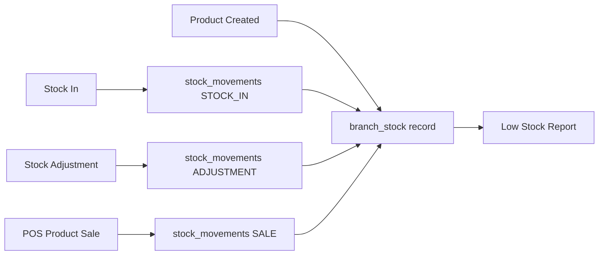

### Frontend Screens
- `StockPage.tsx` — tabs: levels, stock-in, adjustment, movements

### Backend APIs
| Method | Endpoint | Purpose |
|--------|----------|---------|
| GET | `/api/tenant/stock` | Stock levels by branch |
| POST | `/api/tenant/stock/in` | Stock in |
| POST | `/api/tenant/stock/adjustment` | Manual adjustment |
| GET | `/api/tenant/stock/movements` | Movement history |

### Database Tables
- `branch_stock` — branch_id, product_id, quantity
- `stock_movements` — type, quantity, reference, created_by

### Features
| Feature | Status |
|---------|--------|
| Stock in | Implemented |
| Stock adjustment | Implemented |
| Branch inventory | Implemented |
| Low stock threshold (≤5) | Implemented |
| Inter-branch transfer | **Partially Implemented** (TRANSFER enum exists; no dedicated UI/API) |
| Damage tracking | **Partially Implemented** (DAMAGE enum exists; no dedicated UI) |

---

## 9.7 Staff (Employee) Management

**Status:** Implemented (CORE module — always available)

### Purpose
Manage salon staff records, link to user accounts, assign roles.

### Frontend Screens
- `EmployeesPage.tsx`

### Backend APIs
- `/api/tenant/employees` — CRUD, status, assignable roles

### Database Tables
- `employees` — branch_id, user_id, designation, status
- Linked to `users`, `user_roles`

### Performance Tracking
- **Partially Implemented** via Reports → Employee Performance (sales attributed via `sale_item_employees`)
- No dedicated employee KPI dashboard

### Not Implemented
- Dedicated "Hair Dresser" or "Manager" role types (use Employee designation field + custom roles)
- Schedule/shift management
- Commission calculation

---

## 9.8 Branch Management

**Status:** Implemented (requires `BRANCH_MANAGEMENT` feature)

### Frontend Screens
- `BranchesPage.tsx`

### Backend APIs
- `/api/tenant/branches` — CRUD + status

### Database Tables
- `branches` — code, name, is_main, status

---

## 9.9 Sales History

**Status:** Implemented

### Frontend Screens
- `SalesPage.tsx` — filtered list
- `SaleDetailsPage.tsx` — receipt detail

### Backend APIs
- `GET /api/tenant/sales` — list with filters
- `GET /api/tenant/sales/:id` — detail with items, payments, employees

---

## 9.10 Reports

**Status:** Implemented

### Frontend
- `ReportsPage.tsx` — tabbed reports with date/branch filters

### Report Types

| Report | API Endpoint | Content |
|--------|--------------|---------|
| Daily Sales | `/api/tenant/reports/daily-sales` | Sales by date |
| Branch Sales | `/api/tenant/reports/branch-sales` | Sales by branch |
| Service Sales | `/api/tenant/reports/service-sales` | Service revenue |
| Product Sales | `/api/tenant/reports/product-sales` | Product revenue |
| Employee Performance | `/api/tenant/reports/employee-performance` | Sales per employee |
| Low Stock | `/api/tenant/reports/low-stock` | Products below threshold |

---

## 9.11 Settings Module

**Status:** Implemented

### Frontend
- `SettingsPage.tsx` — 4 tabs

| Tab | Status | Features |
|-----|--------|----------|
| Role Permissions | Implemented | Module access editor (requires ROLE_MANAGEMENT) |
| Business & Brand | Implemented | Logo upload, salon name/email/phone |
| Subscription | Implemented | Read-only plan info and enabled features |
| Account & Security | Implemented | Name update, password change |

### Not Implemented
- POS-specific settings (receipt template, default payment method)
- Notification settings (SMS/email)
- Business hours configuration
- Tax rate configuration UI

### Salon Admin Plan Change
- **Partially Implemented:** Backend supports `PATCH /api/tenant/settings/subscription/plan` for salon admins; frontend subscription tab is read-only (no in-app plan upgrade UI)

---

## 9.12 Marketing & Public Signup

**Status:** Implemented

### Screens
- `HomePage` — hero, features, pricing
- `SignupPage` — plan-specific signup
- `SignupSuccessPage` / `SignupCancelPage`

### Backend
- `POST /api/public/signup`
- PayHere webhook + return confirmation

---

## 9.13 Super Admin Modules

**Status:** Implemented

| Module | Screens | Capabilities |
|--------|---------|--------------|
| Dashboard | DashboardPage | Salon counts, recent salons |
| Salons | SalonListPage, SalonDetailsPage, CreateSalonPage | CRUD, status, features, subscription management |
| Plans | PlanListPage | Plan CRUD, feature assignment |

---

# 10. Database Documentation

## Schema Architecture

| Schema | Managed By | Contents |
|--------|------------|----------|
| `public` | Prisma | Platform tables |
| `tenant_XXXXXX` | SQL migrations | Per-salon operational data |

## Public Schema Tables

### tenants
| Column | Type | Purpose |
|--------|------|---------|
| id | UUID | Primary key |
| code | String | SAL000001 |
| schemaName | String | tenant_000001 |
| name | String | Salon name |
| email, phone | String? | Contact |
| logoUrl | String? | Logo path |
| status | TenantStatus | Lifecycle |

### features
Global feature catalog (CUSTOMERS, SERVICES, POS, etc.)

### plans / plan_features
Subscription plan templates

### subscriptions / subscription_features / subscription_payments
Tenant subscription lifecycle

### signup_orders
PayHere checkout tracking

### super_admin_users / super_admin_refresh_tokens
Platform administrators

### password_reset_tokens
Cross-account password reset

### tenant_features
Tenant feature mirror for admin visibility

## Tenant Schema Tables

Applied via migrations `001` through `007`:

| Migration | Tables / Changes |
|-----------|------------------|
| 001_core | branches, users, roles, permissions, user_roles, role_permissions, refresh_tokens |
| 002_business | employees, customers, service_categories, services, product_categories, products |
| 003_transactions | stock_movements, sales, sale_items, sale_item_employees, payments |
| 004_enhancements | branch_stock, audit_logs; customer birthday/notes; sales cashier_id |
| 005_user_permissions | user_permissions (per-user overrides) |
| 006_role_system_flag | roles.is_system |
| 007_appointments | appointments, appointment_services |

## Entity Relationship (Tenant — Simplified)

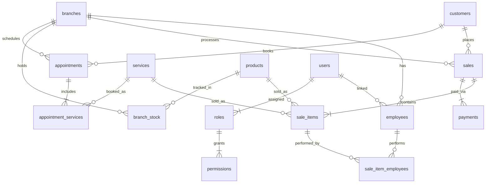

## Indexes (Notable)

- `sales.created_at`, `sales.branch_id`
- `appointments.appointment_date`, `appointments.branch_id`
- `branch_stock(branch_id, product_id)` unique
- `customers.phone`

---

# 11. API Documentation

**Base URL:** `http://localhost:3000/api` (development)  
**Authentication:** Bearer JWT in `Authorization` header (except public routes)

## Public Routes (No Auth)

| Method | Endpoint | Purpose |
|--------|----------|---------|
| GET | `/health` | Health check |
| GET | `/plans` | Active public plans |
| POST | `/public/signup` | Start signup + PayHere checkout |
| GET | `/public/signup/orders/:orderId/status` | Poll signup order status |
| POST | `/public/signup/orders/:orderId/confirm-return` | Confirm payment on return |
| POST | `/public/signup/orders/:orderId/cancel` | Cancel signup order |
| POST | `/payments/payhere/notify` | PayHere webhook |
| POST | `/auth/login` | Login (super admin or tenant user) |
| POST | `/auth/refresh` | Refresh access token |
| POST | `/auth/forgot-password` | Request password reset |
| POST | `/auth/reset-password` | Reset password with token |

## Auth Routes

| Method | Endpoint | Auth | Purpose |
|--------|----------|------|---------|
| GET | `/auth/me` | JWT | Current user profile |
| POST | `/auth/logout` | JWT | Revoke refresh token |

## Super Admin Routes

| Method | Endpoint | Purpose |
|--------|----------|---------|
| GET | `/super-admin/salons` | List salons (paginated) |
| POST | `/super-admin/salons` | Create salon (manual) |
| GET | `/super-admin/salons/:id` | Salon detail |
| PATCH | `/super-admin/salons/:id` | Update salon |
| PATCH | `/super-admin/salons/:id/status` | Change tenant status |
| PUT | `/super-admin/salons/:id/features` | Manual features (non-subscription salons) |
| GET/POST/PATCH | `/super-admin/plans/*` | Plan management |
| PUT | `/super-admin/plans/:id/features` | Plan feature template |
| POST | `/super-admin/subscriptions` | Assign plan (PENDING) |
| POST | `/super-admin/subscriptions/custom` | Custom active subscription |
| POST | `/super-admin/subscriptions/:id/activate` | Activate pending subscription |
| PATCH | `/super-admin/subscriptions/:id/plan` | Change active plan |
| GET | `/super-admin/subscriptions/tenant/:tenantId` | Tenant subscription context |
| GET | `/features` | Feature catalog |

## Tenant Routes (Sample — Full Set)

All require JWT + tenant context. Additional feature/permission guards apply.

| Module | Base Path |
|--------|-----------|
| Features | `/tenant/features` |
| Branches | `/tenant/branches` |
| Employees | `/tenant/employees` |
| Customers | `/tenant/customers` |
| Appointments | `/tenant/appointments` |
| Service categories | `/tenant/service-categories` |
| Services | `/tenant/services` |
| Product categories | `/tenant/product-categories` |
| Products | `/tenant/products` |
| Stock | `/tenant/stock` |
| POS | `/tenant/pos/sales` |
| Sales | `/tenant/sales` |
| Dashboard | `/tenant/dashboard` |
| Reports | `/tenant/reports/*` |
| Settings | `/tenant/settings/*` |

### Example: Create Customer

```
POST /api/tenant/customers
Authorization: Bearer {token}
Feature: CUSTOMERS
Permission: CUSTOMER_CREATE

Request:
{
  "name": "Jane Doe",
  "phone": "0771234567",
  "email": "jane@example.com",
  "birthday": "1990-01-15",
  "notes": "Prefers morning appointments"
}

Response: 201
{
  "id": "uuid",
  "code": "CUST-0001",
  "name": "Jane Doe",
  "phone": "0771234567",
  ...
}
```

---

# 12. Authentication and Security

## Login Flow

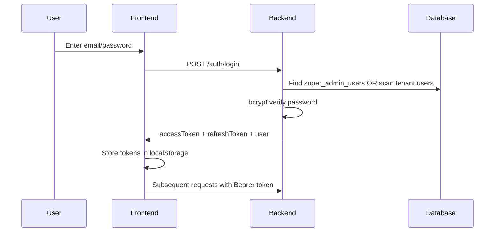

## Token Handling

| Token | Storage | Expiry (default) |
|-------|---------|------------------|
| Access token | localStorage (`salon_saas_access_token`) | 15 minutes |
| Refresh token | localStorage (`salon_saas_refresh_token`) | 7 days |

- Axios interceptor auto-refreshes on 401
- Refresh tokens stored hashed in database
- Logout revokes refresh token

## Password Security

- bcrypt hashing (cost factor 12)
- Password reset via email token (public `password_reset_tokens` table)
- Minimum password rules on reset/signup forms (frontend validation)

## Authorization

- **Role-based:** Super Admin vs tenant roles
- **Feature-based:** Subscription entitlements
- **Permission-based:** Granular RBAC within tenant
- **Throttling:** 100 requests/minute global; tighter on auth endpoints

## API Protection

- CORS configured via `FRONTEND_URL`
- ValidationPipe with whitelist on DTOs
- Tenant schema names validated before SQL execution

## File Access Security

- Logo upload: SALON_ADMIN only
- Static files served from `/api/uploads/` — **Partially Implemented** access control (public static serve; obscurity via tenant UUID filename)

---

# 13. File Upload and Storage System

**Status:** Partially Implemented (logo upload only)

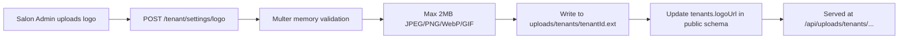

| Aspect | Implementation |
|--------|----------------|
| Upload endpoint | `POST /api/tenant/settings/logo` |
| Delete endpoint | `DELETE /api/tenant/settings/logo` |
| Storage | Local filesystem `{cwd}/uploads/tenants/` |
| Database record | `tenants.logoUrl` (public schema) |
| Image processing | **Not Implemented** (no resize/optimization) |
| General media library | **Not Implemented** |

---

# 14. Deployment Documentation

## Current Infrastructure

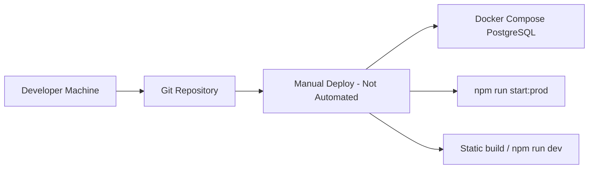

## Docker Architecture

**Partially Implemented**

| Container | Image | Port | Purpose |
|-----------|-------|------|---------|
| postgres | postgres:17-alpine | 5432 | Database only |

**Not Implemented:** Backend container, frontend container, reverse proxy (nginx), SSL termination

## Environment Variables

See `backend/.env.example`:

| Variable | Required | Purpose |
|----------|----------|---------|
| DATABASE_URL | Yes | PostgreSQL connection |
| JWT_ACCESS_SECRET | Yes | JWT signing |
| JWT_REFRESH_SECRET | Yes | Refresh token signing |
| SUPER_ADMIN_EMAIL | Yes (seed) | Initial super admin |
| SUPER_ADMIN_PASSWORD | Yes (seed) | Initial super admin |
| FRONTEND_URL | Yes | CORS |
| PAYHERE_* | Signup | Payment gateway |
| SMTP_* | Password reset | Email delivery |

Frontend: `VITE_API_BASE_URL`

## Build Process

```bash
# Backend
cd backend && npm install && npx prisma generate && npm run build

# Frontend
cd frontend && npm install && npm run build
```

## Deployment Process (Manual — Documented)

1. Start PostgreSQL: `docker compose up -d`
2. Configure `.env` files
3. Backend auto-migrates on startup (`DATABASE_AUTO_SETUP=true`)
4. Run backend: `npm run start:prod`
5. Serve frontend: static files from `frontend/dist` or dev server

**CI/CD:** Not Implemented

---

# 15. Testing Documentation

## Existing Automated Tests

| File | Type | Coverage |
|------|------|----------|
| `app.controller.spec.ts` | Unit | Health endpoint |
| `plans.service.spec.ts` | Unit | Plan service |
| `subscriptions.service.spec.ts` | Unit | Subscription lifecycle |
| `feature.guard.spec.ts` | Unit | Feature guard |
| `tenant-isolation.spec.ts` | Integration | Tenant isolation |
| `test/app.e2e-spec.ts` | E2E | Health check only |

## Manual Test Scripts (`backend/scripts/`)

| Script | Purpose |
|--------|---------|
| `test-appointments-api.ts` | Appointments CRUD |
| `test-api-flow.ts` | General API flow |
| `verify-full-signup-flow.ts` | Signup + payment |
| `verify-settings-apis.ts` | Settings endpoints |
| `test-employees-api.ts` | Employee APIs |
| Others | Login, branches, customers, etc. |

## Testing Approach

- Jest for unit/integration tests
- Standalone TypeScript scripts for manual API verification against running server
- **Not Implemented:** Frontend component tests, E2E browser tests (Cypress/Playwright), load testing

## Important Test Cases (Recommended)

| Area | Priority |
|------|----------|
| Authentication (login, refresh, reset) | High — partially covered |
| Permission enforcement per role | High — partial |
| Feature guard per subscription | Medium — unit test exists |
| POS sale + stock reduction | High — manual scripts only |
| PayHere signup webhook | High — verify script exists |
| Multi-tenant isolation | Medium — spec exists |

---

# 16. Business Process Documentation

## Scenario A: New Salon Self-Service Signup

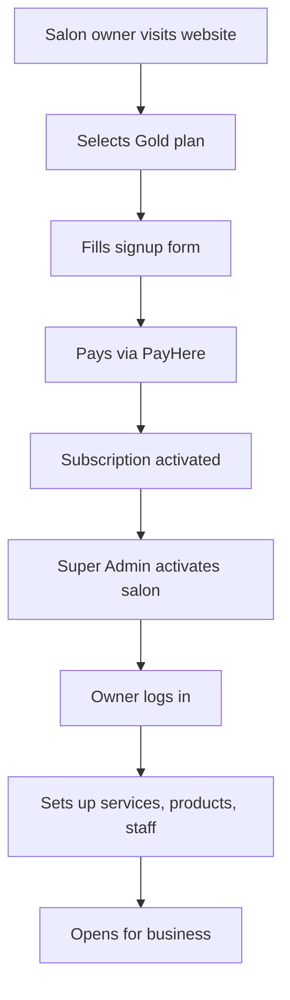

## Scenario B: Walk-In Customer Sale

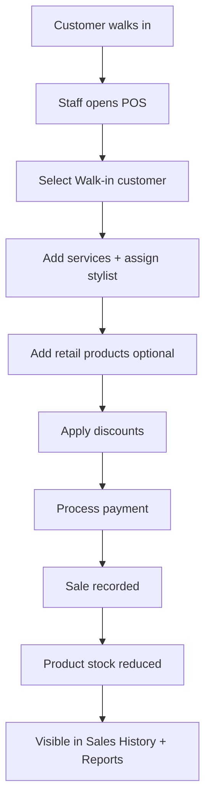

## Scenario C: Appointment-Based Visit

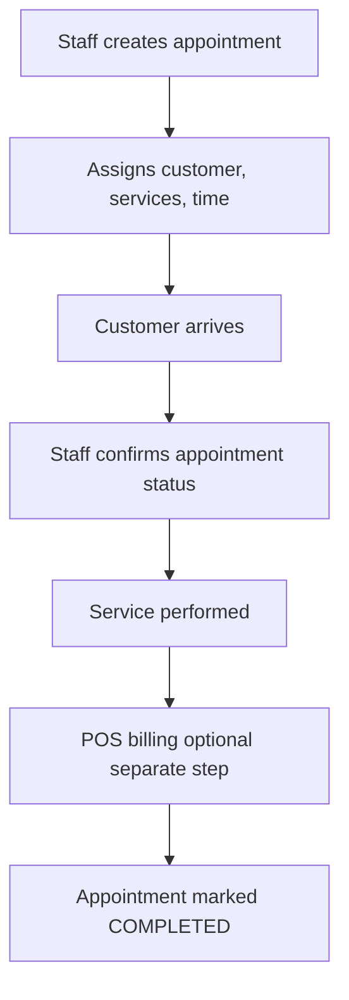

> **Note:** Appointment → POS linkage is **Not Implemented** (manual separate steps).

## Scenario D: Inventory Replenishment

1. Stock Keeper views low stock (Dashboard or Reports)
2. Opens Inventory → Stock In
3. Records quantity received
4. `branch_stock` updated; movement logged

---

# 17. Missing Features / Future Improvements

| Feature | Current Status | Recommendation |
|---------|----------------|----------------|
| Customer online booking | Not Implemented | Public booking portal with availability |
| Appointment staff assignment | Not Implemented | Link appointments to employees |
| Appointment → POS conversion | Not Implemented | One-click bill from appointment |
| SMS/email notifications | Not Implemented | Integrate Twilio/SMTP for reminders |
| Invoice/receipt PDF | Not Implemented | PDF generation + print template |
| Sale refunds | Not Implemented | Refund workflow with stock reversal |
| Service inventory consumption (BOM) | Not Implemented | Recipe/BOM per service |
| Commission tracking | Not Implemented | Employee commission rules |
| Multi-currency | Not Implemented | Currency per tenant |
| Mobile app | Not Implemented | React Native or PWA |
| CI/CD pipeline | Not Implemented | GitHub Actions + Docker deploy |
| Backend/frontend Dockerfiles | Not Implemented | Containerize full stack |
| OAuth/social login | Not Implemented | Google/Microsoft SSO |
| Audit log UI | Not Implemented | Admin view of audit_logs |
| Subscription cancel/suspend API | Not Implemented | Lifecycle management endpoints |
| Salon admin in-app plan upgrade | Partially Implemented | Backend exists; frontend read-only |
| Tax configuration UI | Partially Implemented | Schema supports tax; limited UI |
| Inter-branch stock transfer UI | Partially Implemented | Enum exists; no workflow |
| Hair Dresser / Manager roles | Not Implemented | Use custom roles or designation field |
| Automated subscription renewal billing | Not Implemented | Recurring PayHere/subscription billing |
| Comprehensive E2E test suite | Not Implemented | Playwright/Cypress coverage |

---

# 18. Final System Summary

## Current System Maturity

| Area | Maturity (1-5) | Notes |
|------|----------------|-------|
| Multi-tenant architecture | 4 | Solid schema-per-tenant design |
| Subscription & billing | 3 | Signup flow works; limited lifecycle management |
| Core salon operations | 4 | POS, inventory, customers, services mature |
| Appointments | 2 | Basic staff booking; no online/reminders |
| Reporting | 3 | Good basic reports; no advanced analytics |
| Security & auth | 4 | JWT, RBAC, feature guards |
| Testing | 2 | Limited automated coverage |
| DevOps / deployment | 1 | Local dev only; no CI/CD or full Docker |
| Documentation | 3 | README exists; this document fills gap |

## Strengths

- Clean separation of platform vs tenant data
- Feature-gated subscription model with frozen entitlements
- Comprehensive salon operations (POS, inventory, CRM, reports)
- Modern React + NestJS stack with TypeScript throughout
- Public signup with payment integration
- Flexible RBAC with custom roles (Platinum)

## Weaknesses

- No production deployment automation
- Limited automated test coverage
- Appointments module is basic (no staff assignment, no customer portal)
- No invoice/receipt generation
- File storage is local-only, single-file-type (logo)
- Some enum/schema capabilities lack UI (transfers, refunds, tax)

## Recommended Next Improvements (Priority Order)

1. **Production deployment** — Dockerize backend/frontend, add CI/CD
2. **Automated testing** — E2E tests for signup, POS, permissions
3. **Appointment enhancements** — staff assignment, reminders, online booking
4. **Invoice/receipt PDF** — Essential for salon operations
5. **Subscription lifecycle** — cancel, renew, suspend APIs + salon admin upgrade UI
6. **Audit log viewer** — Super Admin / Salon Admin compliance tool

---

**Document End**

*Generated from codebase analysis of Salon-Saas repository. All feature statuses verified against source code as of September 2026.*
